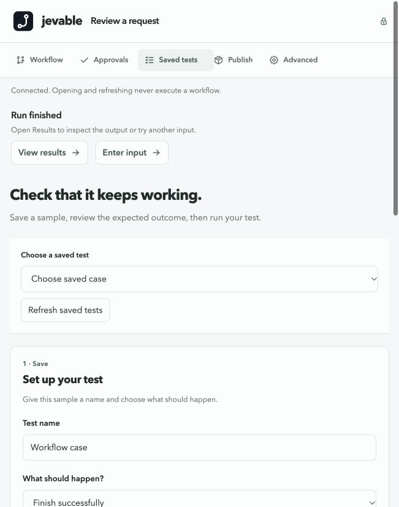
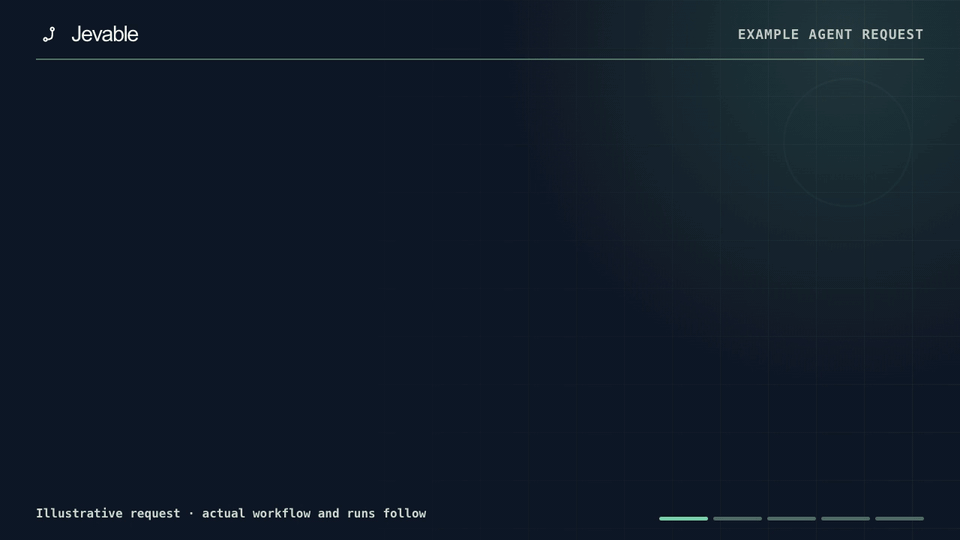
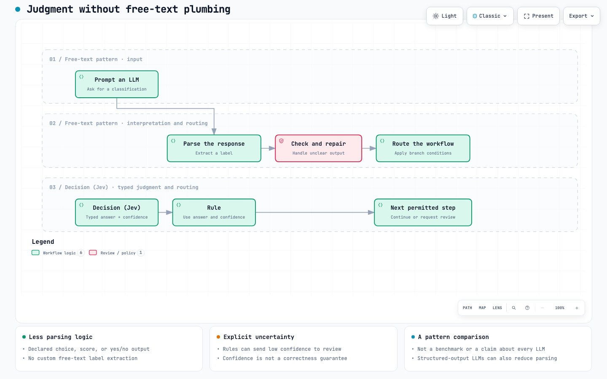
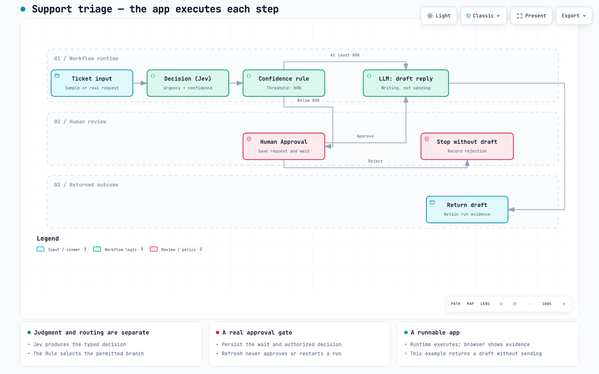
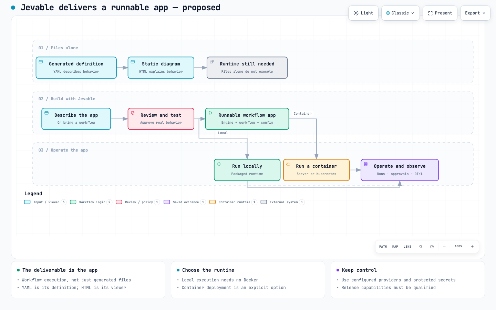
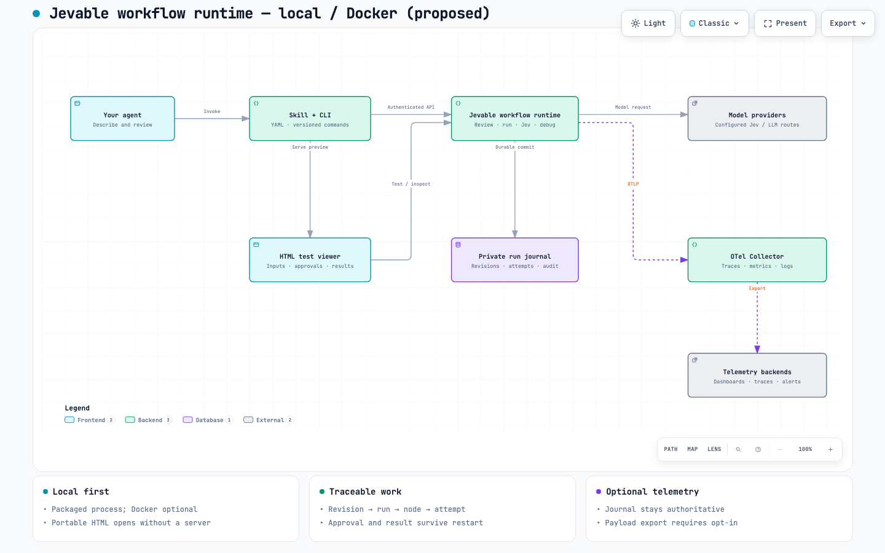
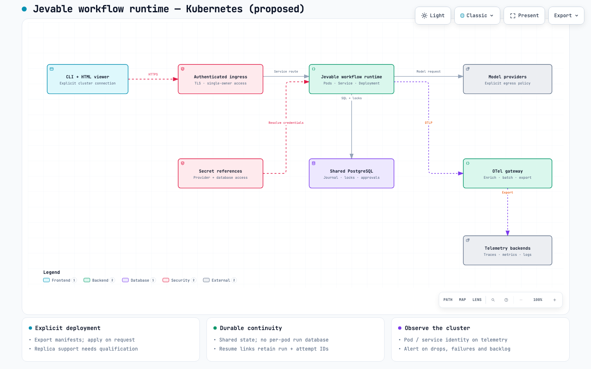
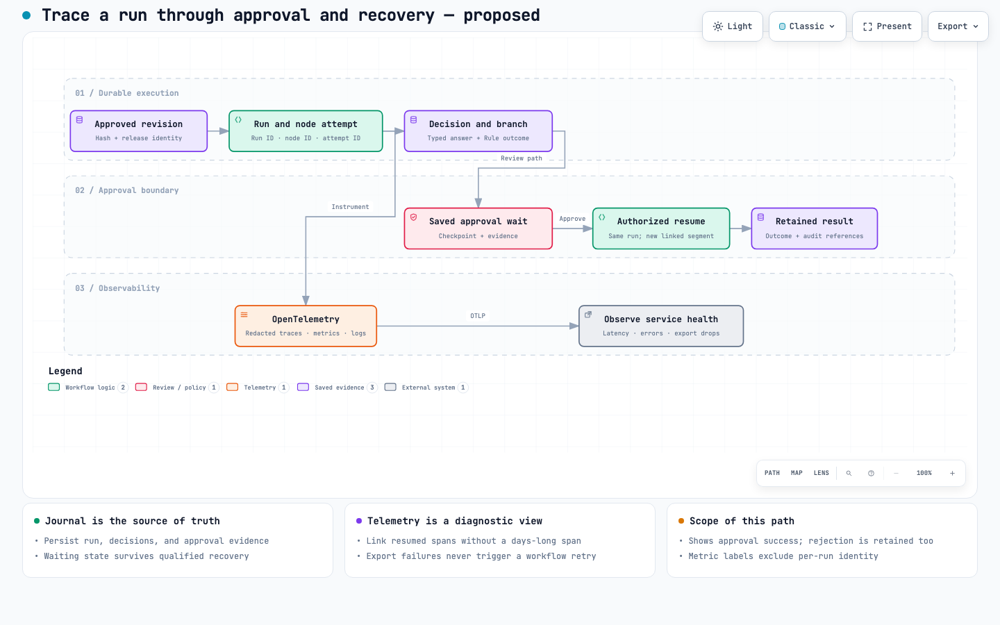
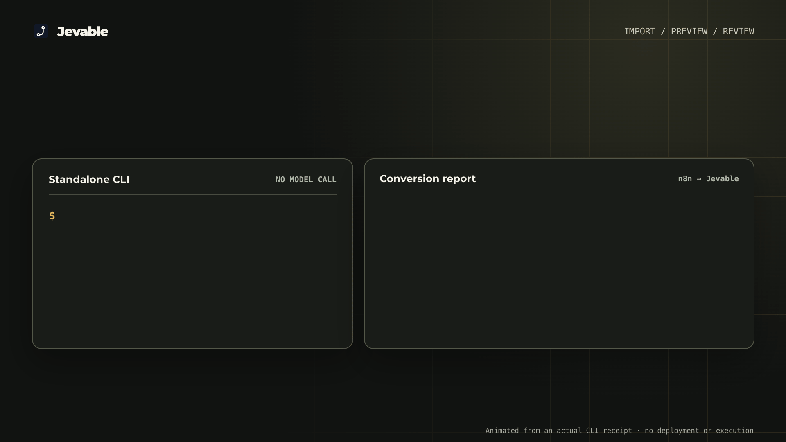
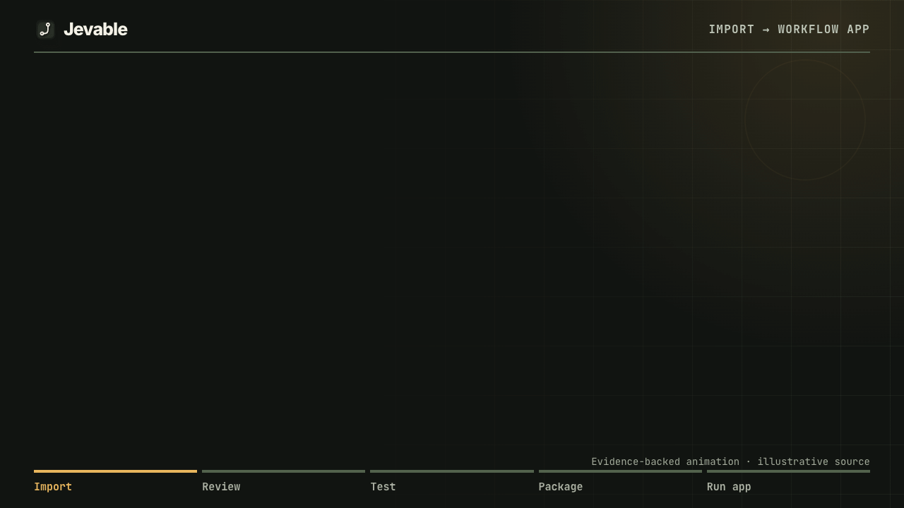

# Jevable Skill

**Describe the work. Get a workflow app you can run.**

Turn support triage, lead qualification, content review and approvals into a repeatable app. Your agent builds it; you review and test it; the **Jevable workflow runtime** runs it independently afterward.

**Build by talking · Test beside your chat · Ship a runnable app · Trace every run**

YAML defines the workflow. HTML lets you inspect it. The deliverable is an entire runnable application with an execution engine, durable state, approvals and operational controls—not just those two files.

## Quick start — one prompt

Paste this into your agent (any agent that can use skills and run Node.js):

> Install the Jevable skill from its trusted ZIP: verify the archive hash, extract it into your approved skill location, then use the skill to run the shipped echo example — no npm install, no Docker, no model account. Show me the run ID and its retained result.

Your agent verifies and extracts the skill, runs the example, and reports the **saved run**. Requires **Node.js 22.19+** only. There is no public installer/download yet; manual installation and archive inspection live in the [skill package guide](references/skill-package.md), and your agent can walk them for you.

### Try a real branch and approval wait — also a prompt

The bundled [Request review workflow](examples/request-review.yaml) has five steps. A Rule sends a routine request straight to Output; a sensitive request pauses at Human Approval. Neither path calls a model or changes an account. Ask your agent:

> Using the Jevable skill, run both shipped request-review inputs into one private state directory, then show me the waiting approval and its run IDs. Do not approve it.

The first run completes with the onboarding-guide message. The second reports **waiting** (exit code 3), not success or failure: its billing-account message has not been acted on. Save the returned run IDs; do not approve the request merely to finish the example. Each run without its original retained ID starts a new run. [Approval safety and review](references/approvals.md).

## Start with an idea — a prompt

Once your agent has installed the skill (from the quick start above), just describe the app you want:

> Use Jevable to build a runnable support-triage app. Classify urgency with a Decision (Jev) node. Ask for my review when confidence is below 80%, then draft a reply without sending it. Open its preview beside this chat so I can inspect and test both paths. After I review the results, package a runnable release ZIP; don't deploy it yet.

To change it:

> Raise the review threshold to 90%. Show me the difference before applying it, then let me test the change.

AI steps require your selected provider configuration and may incur charges. Unsupported integrations stay visible; acceptance, execution, approval and deployment are separate decisions.

## Preview and test beside your chat

Ask your agent:

> Open this workflow's live preview in this app, beside our chat, without running anything.

With an exposed, permitted browser tool, your desktop agent can show the viewer beside the conversation. Otherwise it supplies the local URL. The agent provides the window; Jevable provides the runtime. Opening the preview never executes or approves anything.

The locally bundled Animate UI workspace has **Workflow**, **Approvals**, **Saved tests**, **Publish** and **Advanced** tabs. The graph runs left to right. Start with **Try it**, inspect a step's recorded result, and use **Approvals** when a run needs your decision. Advanced JSON and debugging remain available without filling the default view.

For a live local preview, ask your agent:

> Start the shipped approval example's live preview on my machine, keep it in the foreground, and give me the reported URL plus the access-key instructions. Never paste the token into chat.

Your agent creates a private token file, starts the preview and reports the URL. Token creation refuses an existing file; your agent will reuse an appropriate private token instead of overwriting it. Open the **reported** URL, choose the access-key file or use the protected password field, then choose **Connect**. The key file is read locally, not uploaded. Never put the token in chat or a URL. Keep the foreground preview running while reviewing it; opening or connecting never runs or approves anything.

On your own trusted computer, repeated key entry can be avoided with a protected `.env` token — ask your agent to set that up once:

> Set up automatic local preview connection for the Jevable skill using a protected .env token, then connect me without asking for the key again.

The owner key stays server-side; the browser gets a project-only session. This opt-in trusts other local processes, so use manual connection on shared/untrusted machines. Docker/remote-owner gateways do not support it. [Token generation and security boundary](references/live-preview.md#automatic-local-connection).

| Preview | Purpose | Executes new work? |
| --- | --- | --- |
| [Portable HTML](references/preview.md) | One self-contained file for exploring steps and explicitly included evidence | No |
| [Live viewer](references/live-preview.md) | Inputs, real tests, recorded results, approvals and guarded debugging | Only when explicitly requested |

For a portable inspection-only file, ask your agent to export the approval example's preview HTML.

A model-free approval and saved-test journey has been exercised in Codex's embedded browser. Broader browser coverage, first-time-user usability, accessibility and enforced CSP qualification remain open. Installing the skill does not install a browser. [Same-app handoff and fallback](references/live-preview.md#desktop-agent-preview).

### See a saved test in action

Real browser captures of the shipped approval example, with shortened pauses. No model account or outside action is involved. The test matches its expected approval wait; the workflow is **not finished**, and nothing is approved automatically. This is a screenshot sequence, not a continuous recording or a native Jev demonstration.

### See Decision (Jev) route two tickets

This is an **animation of an actual six-node workflow and retained runtime/test results**, not a screen recording of agent authoring or a hosted-model demonstration. A private synthetic local Jev model chose support at 94% confidence for a product-help ticket; the saved test matched five checks and returned an **unsent** draft. It chose billing at 55% confidence for an unrecognized payment; the second saved test matched three checks and stopped at Human Approval, with **no draft or send**.

### From idea to a runnable app

This 12-second **illustration**, not a screen recording or one continuous run, explains the delivery path. It uses Jevable's existing support-flow diagram and shows why the ZIP is more than YAML or HTML: the exported app includes its own runtime, workflow and manifest. The separate [support-triage example above](#see-decision-jev-route-two-tickets) contains actual runtime and saved-test evidence using a private synthetic local model. The animation implies no sent email, automatic approval or hosted model.

## Jev decides. The LLM writes.

Use **Rules** for known facts and thresholds, **Decision (Jev)** for typed judgment, and **LLM** steps for writing. A Decision returns a validated answer; a following Rule routes it. Judgment stays visible without scattering free-text parsing and label-cleanup steps throughout the graph.

| Decision | Example | Returned judgment |
| --- | --- | --- |
| Choice | High, medium or low urgency? | Declared choice, probability distribution and confidence |
| Score | How well does this lead fit our rubric? | Numeric rubric score and confidence |
| Yes/no | Does this ticket request a refund? | Native Jev's Noul proposition probability; no separate confidence field |

The compatible LLM decision path has a separate confidence-bearing contract. [Native Jev/Laya setup](references/systemone.md) preserves the distinction through explicit `systemone-v1` configuration. Real hosted providers still need qualification; confidence is not a correctness guarantee.

[Explore the Archify comparison](architecture/jev-comparison.html). Structured-output LLMs can also reduce parsing; this compares patterns, not every LLM product. Fewer repair steps can reduce avoidable calls, but actual cost depends on your workflow and models.

[Explore the support-triage flow](architecture/triage.html). Approval and drafting stay explicit and independently inspectable.

## Why a workflow instead of a pure agent?

**Let the agent design the process. Let the workflow runtime repeat it.** An agent is useful when discovering the next step is the job. A workflow is useful when a reviewed process should run repeatedly.

| For recurring work | Agent choosing steps at run time | Jevable workflow |
| --- | --- | --- |
| Control | Instructions and tool permissions guide each action | Accepted graph defines steps, branches and approval gates |
| Review | Review instructions and execution history | Review the exact revision diff before acceptance |
| Testing | Evaluate representative task outcomes | Save cases for outcomes, routes and approval waits |
| AI usage | Planning/tool selection may use models on every request | Rules handle known logic; Jev judges; LLMs write |
| Continuity | Depends on the surrounding agent system | Retained run IDs, approval attempts and explicit recovery |
| Delivery | Depends on the surrounding application | Runnable releases with correlated execution evidence |

An agent-built custom app can also be deterministic, tested and observable. Jevable supplies shared orchestration, approvals, state, tests and telemetry so you do not rebuild those pieces for every process. Choose custom code when behavior exceeds the engine's supported capabilities. A fixed graph does not make model answers deterministic or guarantee exactly-once external effects.

## Ship the app—or share its definition and preview

[Explore app delivery](architecture/app-delivery.html). The **skill** authors and reviews; the **Jevable workflow runtime** executes. Exported apps need neither the skill nor the authoring conversation.

| Output | Use it for | Docker needed to export? |
| --- | --- | --- |
| HTML | Explore the graph and selected evidence; not executable | No |
| [Editable project JSON/ZIP](references/transfer.md) | Move definitions and optional reviewed history/tests | No |
| [Runnable release ZIP](references/releases.md) | Execute one reviewed workflow with its bundled Node runtime | No |
| [Container image](references/images.md) | Run the workflow release and runtime in a container | Yes |
| [Image archive (`.tar`)](references/images.md) | Transfer a built image for a separately reviewed load | Yes |
| [Kubernetes bundle](references/kubernetes.md) | Review exact-runtime manifests before an explicit apply | No; needs an already reviewed image receipt |
| [Management Kubernetes bundle](references/management-images.md#kubernetes-management-export) | Run the full management CLI/API with a dedicated PostgreSQL journal | No during export; requires a reviewed management image |

An extracted release runs a one-shot headless job or its exact-release HTTP service — both started for you by your agent from a prompt. No npm install or authoring checkout is needed. Providers, credentials and persistent storage still need configuration. Exporting never executes, publishes or deploys; inspect authored source for inline secrets before sharing.

**Fully local, with an interface or headless:** start the exported app's browser interface when you want to run, approve and inspect work visually. The same app can instead run a one-shot CLI job, save its state and exit; later `show`, `review` and authorized `decide` commands use that retained state from separate processes. Neither mode needs the Jevable desktop app, Docker or a cloud account. The interface keeps a local HTTP process while open; headless jobs need no always-on Jevable process. Do not start a direct SQLite job against a running interface's owned state; use its authenticated API. Automatic scale-to-zero event delivery still needs a local scheduler/event platform and qualification. [Local execution boundaries](references/releases.md#local-interface-and-headless-jobs).

### Open the exported app in a browser — a prompt

After you have a trusted **runnable release ZIP**, ask your agent:

> Verify and extract this runnable release ZIP into its own folder, start its local browser interface in the foreground, and give me the reported URL and the private owner-token location. Never display the token itself.

Your agent verifies and extracts the release, creates the private token file, serves the app and reports the URL. Open it in your browser—or ask your desktop agent to open that URL beside your chat. Enter the token from the private token file in the page, then choose **Open workflow**. The app itself shows a left-to-right workflow, **Run**, **Log**, **Approvals** and **Guide**. Common inputs become labelled fields, valid choices and add/remove lists; flexible schemas keep a JSON editor, and a guided form can switch to JSON without losing a complete draft. Opening the page only displays the workflow; **Run workflow** starts a saved run, and an approval requires you to read the request and explicitly confirm a named decision. Approval requests, results and recorded values show readable field names, with exact JSON available on demand. Each graph step says whether it completed, is waiting or was not reached; **View audit events** reads the saved event kinds/times without rerunning. Private values need a separate click. Guide can show the authenticated API reference. The token grants *all* operations, including private run inspection and decisions, so never paste it into a URL or chat. This local server is the exported **Jevable workflow runtime**, not the skill, desktop app or authoring preview. Stop it with Ctrl-C after its graceful-drain receipt. [Exact-release serving and limits](references/releases.md#serve-the-exported-app).

Need another person to decide **only one request**? Ask your agent to start the exported app with reviewer decisions enabled, then create a one-request review token for that waiting item. Send the `/review` page link and the displayed token separately through a trusted channel. They see only their assigned review and must confirm before deciding; they never receive your owner token, run history or workflow source. The token permits only that node's explicitly selected named actions, including custom names such as `requestChanges`. [Reviewer setup and limits](references/releases.md#optional-separate-reviewer-page).

## Run locally, in Docker, or on Kubernetes

| Mode | Execution and state | Observability |
| --- | --- | --- |
| Local | Optional browser interface with authenticated API, or direct SDK/CLI jobs; private SQLite by default, explicit PostgreSQL optional; no Docker required | The same durable run history; optional OTLP |
| Docker | Workflow runtime image with protected configuration and persistent storage | Same run identities and signals |
| Kubernetes | Single-owner PostgreSQL workflow runtime, restricted pods and authenticated service | Explicit OTLP and real pod metadata |

SDK imports do not start a server. Choose HTTP for a persistent API, live testing or a shared service. Docker/Kubernetes run the **Jevable workflow runtime**, not a “skill runtime.” This core does not attach to Jarness, the Jevable desktop app or their credentials/state; a future desktop app can consume it.

Want an event to start your app? [Signed webhook intake](references/webhooks.md) verifies Standard Webhooks v1 signatures and maps each retained message ID to one run of your reviewed release. It is opt-in, with separate signing keys and bounded capacity; producers cannot read private results or approve steps. A signed delivery acknowledges admission, not completed business work.

[Explore local/Docker](architecture/standalone.html) · [Editable source](architecture/standalone.architecture.json)

[Explore Kubernetes](architecture/kubernetes.html) · [Editable source](architecture/kubernetes.architecture.json)

These Archify diagrams are architecture views, not screenshots or proof every pictured component is deployed. The unpublished Kubernetes-guide candidate passed a four-image Linux arm64 matrix on an isolated Docker Engine and selected single-node k3s checks with its exact PostgreSQL workflow image: verified TLS execution, PVC-backed readback, normal replacement and clean restart, received Collector traces/logs/metrics, and fail-closed recovery after one short-grace database Pod deletion and one database-container SIGKILL. Both faults used idle synthetic runs; recovery required an explicit workflow-owner replacement. The **same image bytes** also passed independent selected Minikube checks for admission, verified TLS, a synthetic run, normal workflow replacement and a paired Calico policy probe. After an earlier `/tmp`-profile loss, a **fresh durable-profile** Minikube fixture separately passed one short-grace PostgreSQL Pod deletion: the old owner refused with `503 ownership-lost`, an explicit replacement read the unchanged original run/evidence, and the same PVC/run survived an outer-VM restart. A test-only Collector with append-mode JSONL files on a PVC retained data through normal replacement and a clean restart, but a later forced Collector task loss left one malformed metrics record boundary; it is **not** a crash-safe telemetry backend. Other pinned builds' results are not transferred. These checks do **not** qualify active external effects, automatic failover, node/PVC loss, durable telemetry retention, multi-node or production deployment, public registry provenance, or other platforms. The tested alternate Engine does not establish that Docker Desktop's Engine is healthy. [Deployment and qualification scope](references/kubernetes.md).

## Trace the decision, not just the error

[Explore traceability](architecture/traceability.html) · [Explore approval recovery](architecture/approval-runtime.html)

Follow workflow versions, node attempts, decisions, branches, approvals and outcomes. Optional **OpenTelemetry traces, metrics and structured logs** correlate with retained evidence; OTLP HTTP/protobuf and explicit gRPC are supported.

The journal is the source of truth. Sampled, delayed or missing telemetry never reconstructs results or reruns work. Prompts, inputs, outputs and secrets are excluded from telemetry by default. Metrics describe execution and exporter health—not billing, a distributed queue or complete HTTP accounting merely because records arrived.

[Telemetry configuration](references/telemetry.md) · [Retained trace navigation](references/trace-navigation.md) · [Optional Collector/Prometheus/Tempo/Loki/Grafana profile](references/observability.md). Backend dashboards, actual browser navigation and production observability remain separately unqualified.

## Bring an existing workflow

Owned converters handle **Coze, Dify, n8n, Zapier, Make and Power Automate** exports. Review exact, approximate and unsupported conversions before running anything. Importing a connector's shape does not make its source-platform integration executable. Start with a prompt:

> Preview my vendor workflow export with the Jevable skill and show me the offline conversion report — what mapped exactly, what is approximate, and what needs repair. Create nothing runnable yet.

Your agent runs the offline preview and hands you a private conversion report/graph, not a runnable app. [Import review and provenance](references/vendor-imports.md).

### Conversion examples — n8n and Dify

Every row links the **original vendor workflow**, the **Jevable deliverable** it produced, and the evidence for that deliverable.

| Platform | Original workflow | Jevable deliverable | Node functions covered | Evidence |
| --- | --- | --- | --- | --- |
| **n8n** | [n8n.json](examples/import-support/n8n.json) · [guide](references/import-support.md) | [reviewed.yaml](examples/import-support/reviewed.yaml) (runnable reviewed draft) | manual trigger · if · LLM chain · JS code · no-op | [import-support walkthrough](references/import-support.md) · [journey to release ZIP + extracted-app runs](references/import-support.md) |
| **Dify** | [dify.json](examples/import-dify/dify.json) (DSL v0.1.5) | [reviewed.yaml](examples/import-dify/reviewed.yaml) (runnable reviewed draft, all-exact mapping) | start variables (select enum, required) · if-else (`is`) · end outputs | matrix receipt — this exact shipped example re-imported, released and executed **completed** (2026-11-05) |
| **n8n** | 10 originals in archive | 10 reviewed drafts + 10 release ZIPs executed (in the same archive) | manual/webhook/schedule triggers · if (string + numeric) · switch + default · LLM chain · agent · JS + Python code · splitInBatches loop · unsupported httpRequest · combined graph | matrix receipt — **10/10 executed with expected results** |
| **Dify** | 10 originals in the same archive | 10 reviewed drafts + 10 release ZIPs executed (in the same archive) | start variables (text/number/select/paragraph, required/optional, enums) · end outputs · if-else (`is`/`>`/`empty`, `and`/`or`) · LLM prompt templates · JS + Python code · iteration loop · unsupported template-transform | same receipt — **10/10 executed with expected results** |

End-to-end journeys from original export to a running, approved, logged app (with step-by-step screenshots): n8n + Dify E2E receipt and the first-time-user journey report.

Try it with a prompt:

> Import my n8n export with the Jevable skill. Show what converted and what needs repair. Propose a simpler Decision (Jev) step where appropriate, then let me review and test it. Package the supported workflow as a runnable app without deploying it.

> Import my Dify DSL with the Jevable skill, list every exact, approximate and unsupported mapping, and wait for my review before creating anything runnable.

What to expect from the converters today: supported n8n triggers/if/switch/LLM/code convert to drafts (exact or approximate); loops convert only in recognized body patterns; Dify start/end/if-else (`cases:` shape)/LLM/JS-code convert; anything else becomes a clearly-marked placeholder that **must** be re-authored during review — the imported draft never runs as-is. Recorded end-to-end journeys with screenshots: n8n + Dify receipt.

This short animation uses the real CLI conversion receipt for the illustrative n8n-shaped example. It is **not a screen recording**, and the generated draft is **not runnable yet**: the diagnostic and “not-run” state are deliberately visible. [Inspect the conversion and review steps](references/import-support.md).

**Breadth-tested:** a 20-workflow node-function matrix (10 n8n + 10 Dify — triggers, if/switch/numeric/empty/and/or branches, LLM/agent, JavaScript/Python code, loops and unsupported types) imported, reviewed, released and executed end-to-end with **20/20 expected results**, plus a recorded import→run→approve journey with screenshots.

The second GIF follows an actual standalone import → reviewed Jev repair → accepted saved test → ZIP release → fresh extracted app run. It is an **animation of verified CLI/runtime receipts, not a screen recording**. The source is illustrative n8n-shaped JSON, and the Decision calls used a private **synthetic local model**, not a hosted provider or a verified n8n installation. Two installed/extracted skill profiles passed; each saved test checked five assertions, and each exported app independently ran five cases. [Exact qualification and limits](references/import-support.md).

## What works today

Version **0.1.0-alpha.1** is early implementation, not a production release. It includes compilation, ten bilingual templates, six import converters, versioned projects, retained execution/approvals, saved tests, bounded suites, guarded debugging, model routes/retries, authenticated APIs and export packaging. Custom code nodes validate but do not execute; real hosted providers remain unqualified, and browser acceptance covers only the explicitly tested journeys above.

Ask your agent to report this installation's scope (`capabilities`) and any command's actual parser grammar (`help <command> --json`) before relying on it. Implemented code, a passing local fixture and production acceptance are different claims.

### Guides for the next step

| I want to… | Read |
| --- | --- |
| Create, revise and review | [Authoring](references/authoring.md), [projects/SDK](references/projects.md), [schemas](references/schemas.md) |
| Set up model calls | [Providers](references/providers.md), [native Jev/Laya](references/systemone.md), [retained usage](references/usage.md) |
| Save tests and inspect coverage | [Testing](references/testing.md), [suites](references/suites.md), [live preview](references/live-preview.md) |
| Review or stop retained work | [Approvals](references/approvals.md), [controls](references/control.md), [cancellation](references/cancellation.md), [job shutdown](references/job-shutdown.md) |
| Inspect or share evidence | [Journal](references/evidence.md), [evidence ZIPs](references/evidence-packages.md), [activity](references/activity.md), [watch](references/watch.md) |
| Serve or embed a runtime | [HTTP/HTTPS](references/http.md), [async runs](references/async-runs.md), [API entry](references/api-trigger.md), [stable messages](references/release-messages.md), [signed webhooks](references/webhooks.md) |
| Connect to an existing owner | [Remote HTTPS](references/remote.md), [Docker owners](references/docker-owner.md), [PostgreSQL](references/postgres.md) |
| Package an authoring host | [Management ZIP](references/management.md), [management image](references/management-images.md), [skill ZIP](references/skill-package.md) |
| Configure optional access/integrations | [Grants](references/grants.md), [account issuer](references/account.md), [rate limits](references/rate-limits.md), [notifications](references/notifications.md) |
| Operate telemetry | [Collector probe](references/collector-probe.md), [gateway export](references/collector-gateway.md), [trace viewer](references/trace-navigation.md), [observability](references/observability.md) |
| Find a command or troubleshoot | [CLI help](references/cli-help.md), [doctor](references/doctor.md), [development](references/development.md), [architecture](architecture/README.md) |

Signed intake is an opt-in exact-release Standard Webhooks v1 profile; public-network/proxy deployment is not qualified. Scheduling, signed approval links and distributed quotas remain open. Other architectures/distributions, production database provisioning/backup/restore, forced-loss recovery, real-provider compatibility, browser/GIF acceptance and finalized licensing/distribution also remain open. Private source-checkout plans and qualification receipts are not shipped inside the skill.
