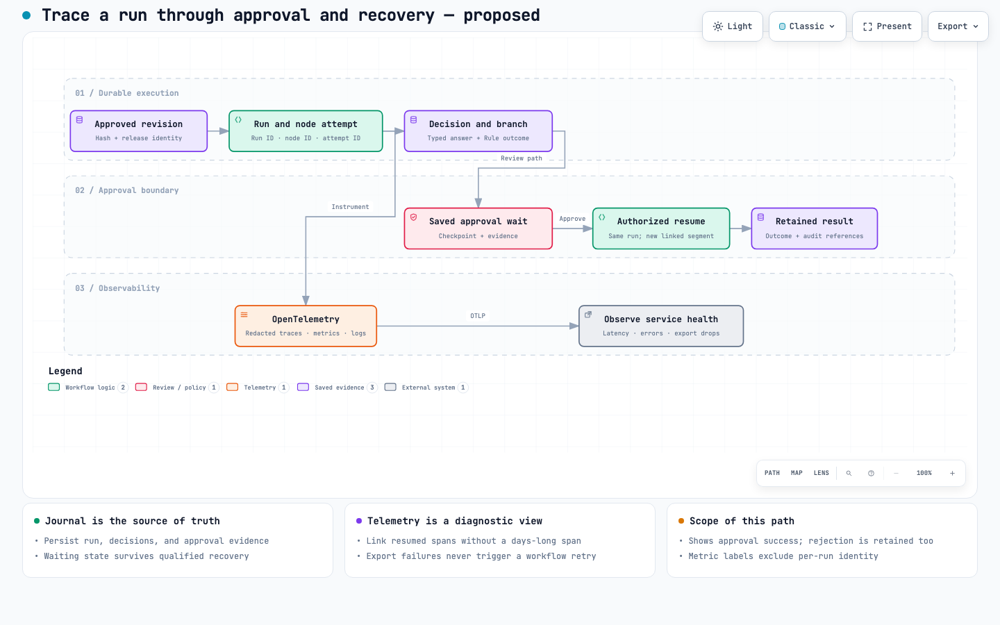
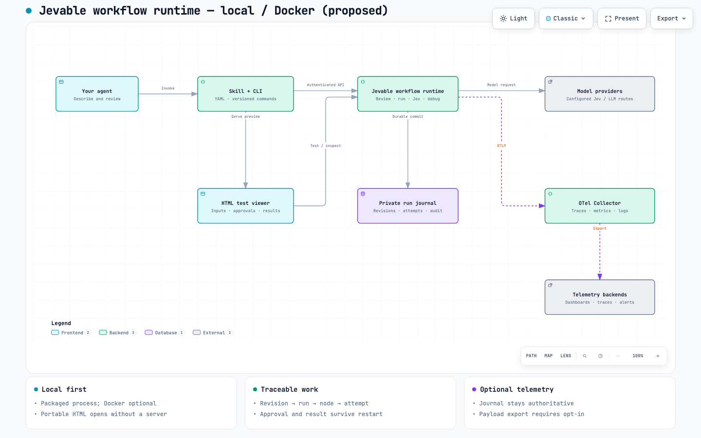

# Jevable architecture diagrams

These portable design maps cover the standalone Jevable core, CLI, HTML viewer, workflow runtime, persistence and telemetry. They include planned deployment responsibilities; they do not prove those deployments work. Read the [current implementation guide](../references/development.md) and each runtime guide for available commands and qualification limits.

## Explore the deployment diagrams

| Diagram | Interactive artifact | Editable source | Browser evidence |
| --- | --- | --- | --- |
| Jevable workflow runtime — local / Docker | [Open HTML](standalone.html) | [Architecture JSON](standalone.architecture.json) | [Light/dark contact sheet](standalone.visual-check.html) |
| Jevable workflow runtime — Kubernetes and OTel gateway | [Open HTML](kubernetes.html) | [Architecture JSON](kubernetes.architecture.json) | [Light/dark contact sheet](kubernetes.visual-check.html) |
| Files alone versus a runnable app | [Open HTML](app-delivery.html) | [Workflow JSON](app-delivery.workflow.json) | [Light/dark contact sheet](app-delivery.visual-check.html) |
| Free-text classification versus Decision (Jev) | [Open HTML](jev-comparison.html) | [Workflow JSON](jev-comparison.workflow.json) | [Light/dark contact sheet](jev-comparison.visual-check.html) |
| Support app execution and approval branches | [Open HTML](triage.html) | [Workflow JSON](triage.workflow.json) | [Light/dark contact sheet](triage.visual-check.html) |
| Run evidence, approval recovery, and OTel | [Open HTML](traceability.html) | [Workflow JSON](traceability.workflow.json) | [Light/dark contact sheet](traceability.visual-check.html) |

Every diagram and flowchart image in these docs was generated with Archify. This package includes editable JSON, interactive HTML and the light/dark screenshots used by its contact sheets. The HTML embeds its graph and viewer; no Archify installation or Jevable server is needed to explore it. Its optional Google Fonts stylesheet may make a network request; offline viewing uses system-font fallbacks. The [Archify license notice](../notices/archify-MIT.txt) is included.

These documentation diagrams do not run Jevable workflows. The product they describe is a standalone runnable workflow app, not a diagram generator: it combines workflow behavior with a compatible runtime, configuration and operational state. For actual inspect-and-test sessions, read the [experimental live preview guide](../references/live-preview.md); opening a page never executes or approves work.

The separate [approval-runtime diagram](approval-runtime.html) ([source](approval-runtime.workflow.json)) describes the implemented [approval example](../examples/approval.yaml), distinguishing its three workflow nodes from rejection/expiry runtime outcomes. Its recorded Archify structural checks passed, but current-artifact visual review is not complete. The six diagrams in the table retain their earlier visual review; that is separate from workflow testing.

The component maps intentionally summarize logical responsibilities. They are not network-policy manifests: return paths, probes, database backups, artifact storage, and individual telemetry backends are omitted for readability. Kubernetes replica safety remains a qualification gate, not an assumed capability.

## Runtime boundaries

The Jevable skill is the agent-side authoring guidance and tooling. The Jevable workflow runtime is the independent process or service deployed locally, in Docker, or on Kubernetes. The skill/CLI calls its APIs; it is not the workload deployed to the cluster. Management mode and release execution mode expose different qualified runtime capabilities.

| Work | Runs where | Needs a listening service? |
| --- | --- | --- |
| Author YAML | User's agent | No |
| Compile and render portable HTML | CLI using packaged libraries | No |
| Durable projects, revisions, approvals, execution | Jevable workflow runtime through SDK/CLI | No for direct jobs; optional authenticated service for remote clients |
| Run an exported workflow ZIP or image | Its pinned Jevable workflow runtime | No for CLI jobs; yes when explicitly serving its API |
| Explore exported HTML | Browser | No |
| Start tests or approve a waiting run in HTML | Authenticated viewer connected to selected runtime | Yes |
| Send observability signals | Runtime's OTel instrumentation | Only the configured telemetry endpoint; optional locally |

This is not an SDK-only design. Reusing libraries for offline tasks avoids unnecessary servers; durable execution still uses the maintained runtime. The core never depends on Jarness, the old harness, desktop services or their state. Future desktop adapters consume the core, not the reverse. [Runnable release ZIPs](../references/releases.md), [Docker images](../references/images.md) and [Kubernetes bundles](../references/kubernetes.md) contain the Jevable workflow runtime, not an authoring skill workload. Kubernetes changes ownership and persistence, not the workflow language; actual cluster qualification remains open.

## Causality across an approval wait

The same run survives the wait; a live span does not have to. The following illustrates the successful-approval path. Local fixture qualification covers retained approval and linked segments, not every deployment, Collector or interruption scenario:

[Explore the Archify flow](traceability.html). The runtime commits the waiting state and ends its active execution segment. An authorized decision is recorded atomically with resume ownership; execution continues in a new linked segment under the same run identity.

Rejection, cancellation, and failed recovery retain their own terminal evidence. An uncertain external effect requires inspection and the connector's retry policy; trace correlation cannot provide exactly-once execution.

## One run, two evidence paths

[Explore the Archify component map](standalone.html). The runtime writes to its journal independently of the optional Collector pipeline. The Collector forwards redacted signals to configured trace, metric, and log backends; bounded queues and visible export-drop health prevent silent monitoring gaps from masquerading as complete evidence.

The journal answers **what happened to this exact workflow revision?** OTel answers **where did time go, which calls failed, and is the service healthy?** Export can be sampled or fail. That must not erase durable evidence or initiate a new attempt.

Use the [official Collector gateway pattern](https://opentelemetry.io/docs/collector/deploy/gateway/) for central OTLP ingestion and the [Kubernetes Collector chart](https://opentelemetry.io/docs/platforms/kubernetes/helm/collector/) for deployment and metadata enrichment. Optional host-level collection can follow [agent-to-gateway guidance](https://opentelemetry.io/docs/collector/deploy/other/agent-to-gateway/). These are design references, not dependencies installed by this repository.

## Current foundation and release gates

This core owns compilation, templates/import conversion, reviewed projects, SQLite and explicit PostgreSQL execution, providers, retained approvals/controls, saved tests, runnable release packaging and opt-in [OpenTelemetry traces, metrics and logs](../references/telemetry.md). HTML testing controls are experimental and await real-browser qualification. Kubernetes export is offline packaging, not proof of a deployed cluster. Managed multi-user/public ingress, production providers/database operations, broader recovery and full deployed observability remain separate gates.

Before claiming full traceability, prove the joins from revision → run → node/loop → attempt → decision/approval → result, including restart and retention behavior. Before claiming full observability, prove correlated signals, privacy controls, export-loss visibility and cluster recovery. A trace ID, diagram or successful package build is not proof of external delivery or exactly-once execution. Consult the [telemetry contract](../references/telemetry.md) and [optional local observability profile](../references/observability.md).

## Diagram review scope

The two deployment diagrams are type `architecture`; the four comparison/execution diagrams are type `workflow` using schema v2. All were delivered with Archify's `showcase` profile on 2026-09-29. Each passed **9/9 checks, 0 composition errors, 0 warnings**. Browser containment, readability, and viewer controls passed at 1440×900, 1600×1000, 1920×1080, and 2048×1320. Light/dark screenshots at the smallest and largest sizes were visually inspected: `visual_review: passed`. This confirms the diagram presentation, not runtime functionality. No interactive workflow execution was tested.

This package update does not regenerate diagrams, rerun their browser review or qualify workflow execution. Developer receipts with local paths and private fixture evidence stay in the source repository; they are not installed documentation. Ordinary unlabelled flowchart edges convey sequence already implied by their endpoints; decision conditions, approval outcomes, deployment choices and telemetry mechanisms retain explicit labels. The package checker verifies installed links and asset bytes, not visual appearance.
